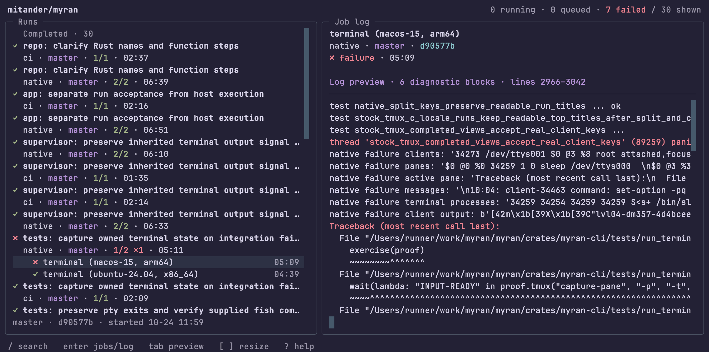

# Bronson

Bronson is a terminal UI for GitHub Actions and GitLab CI.

Browse recent runs, expand their jobs, and search completed logs without leaving the terminal. It
uses `gh` for GitHub and `glab` for GitLab authentication and API access.



## Install and run

You need Python 3.10 or newer, Git, [pipx](https://pipx.pypa.io/), and
[GitHub CLI](https://cli.github.com/) (`gh`) or [GitLab CLI](https://gitlab.com/gitlab-org/cli)
(`glab`).

```sh
git clone https://github.com/mitander/bronson.git
pipx install ./bronson

gh auth login
cd /path/to/your/repository
bronson
```

You should see recent workflow runs from the repository's `origin`. If `bronson` isn't on your
`PATH`, run `pipx ensurepath` and reopen your terminal. To choose a GitHub repository from any
directory:

```sh
bronson --repo owner/repository
```

After pulling changes, update with `pipx install --force ./bronson`. Uninstall with
`pipx uninstall bronson`. For an editable checkout or a virtual-environment installation, see
[CONTRIBUTING](CONTRIBUTING.md).

<a id="keybindings"></a>

## Basic navigation

Use arrows or `j`/`k` to move, Enter to expand runs and open job logs, and Esc to go back. Press `/`
to filter the fetched runs or search an open log, `o` to open the selected run or job in your
browser, and `q` to quit. **Press `?` for all shortcuts.**

On GitHub, `r` reruns failed jobs, `R` reruns all jobs, and `c` cancels a queued or running run.
These keys send requests immediately, without a confirmation dialog. Quitting Bronson does not undo
an action already accepted by GitHub. GitLab is read-only.

<a id="self-hosted-gitlab"></a>

## GitLab

For gitlab.com, run `glab auth login`, then `bronson` from a checkout. For a self-hosted instance:

```sh
glab auth login --hostname gitlab.example.com
bronson --provider gitlab
```

Replace `gitlab.example.com` with your instance's hostname. Bronson reads the host and project path
from `origin`, including nested groups. Outside a checkout, select both explicitly:

```sh
bronson --provider gitlab --host gitlab.example.com --repo group/subgroup/project
```

<details>
<summary>Host selection, authentication and compatibility</summary>

GitHub and gitlab.com origins select their provider automatically. Other hosts require
`--provider gitlab`. An explicit `--repo` ignores the current directory's origin. Without `--host`,
`--provider gitlab --repo group/project` selects gitlab.com.

`--host` accepts a hostname with an optional HTTPS port, not a URL. SSH origin ports do not change
the HTTPS API port. Configure HTTPS, custom CA trust and instance-specific API settings in `glab`.
GitHub Enterprise and GitLab installations under a URL subpath are not qualified.

Bronson uses `glab`'s saved login for the selected host. It does not forward `GITLAB_TOKEN`,
`GITLAB_ACCESS_TOKEN`, `OAUTH_TOKEN` or CI job-token overrides. Ambient API-host and protocol
overrides are also ignored. Sign in with `glab auth login` and configure routing per host instead.
The GitLab backend needs no GitHub credentials.

GitLab requests are GET-only. Retry, cancel and manual-job actions are unavailable. Manual and
scheduled jobs remain waiting, unknown statuses stay visible, and failed jobs with `allow_failure`
are labeled **allowed failure**, not success. Job pagination includes current attempts, not retried
jobs. Child pipelines and bridge/trigger jobs are not expanded. Compatibility with a particular
self-hosted version still needs a read-only smoke test on that instance.

</details>

## Themes

Press `t` to choose a theme, or start with `bronson --theme textual-dark`. Built-in themes work
without additional configuration.

<details>
<summary>Use Flume palettes and follow theme changes</summary>

Bronson reads [Flume](https://github.com/mitander/flume.nvim)'s semantic palette exports directly.
Link Flume's `extras` directory:

```sh
mkdir -p "${XDG_CONFIG_HOME:-$HOME/.config}/bronson"
ln -s /path/to/flume.nvim/extras "${XDG_CONFIG_HOME:-$HOME/.config}/bronson/flume"
```

Bronson loads `flume/palette/flume-*.json` and follows `flume/current/schema`, including live
`:FlumeSync` changes. After editing palette colors, use Flume's normal compile/sync command and
restart Bronson. No separate Textual export or application rebuild is needed.

An explicit `--theme flume-dusk` or selection with `t` pins that theme. Choose **Follow Flume sync**
in the theme picker to resume following the active palette.

Without a configuration link, Bronson also looks in
`${XDG_DATA_HOME:-$HOME/.local/share}/nvim/lazy/flume.nvim/extras`. Set `BRONSON_FLUME_DIR` to
choose a different extras directory. Missing or invalid palettes leave built-in themes available.

Older generated Textual palettes remain supported through `flume-themes` in the Bronson
configuration directory or `tracker-tui` under extras when canonical palette exports are absent. The
`FLUME_TRACKER_THEME_DIR` and `FLUME_SCHEMA_FILE` overrides remain supported.

</details>

<a id="behavior-and-limits"></a> <a id="local-data"></a>

## Limits and local data

Bronson fetches up to 100 recent runs or pipelines. Filtering only searches those fetched runs. Logs
are available after each job finishes, not streamed. Use `o` to view running output in your browser.
Refreshes are automatic, and failed refreshes leave the last successful data visible. Cached
dashboards are startup hints, not fresh provider results. Workspaces and session restore are not
implemented.

Raw logs and dashboard metadata are cached as **unencrypted files** under
`${XDG_CACHE_HOME:-$HOME/.cache}/bronson/logs`, including for private projects. Logs may contain
secrets printed by a workflow. Use a machine and cache location approved for that data. Bronson does
not save CLI authentication credentials. GitHub uses `gh`'s normal authentication environment.

Log writes prune the oldest logs toward a shared 100 MiB cap. Snapshots are outside that cap, and
downloads are buffered in memory, so this is not a total disk or memory limit. To discard local
data, stop Bronson and remove its cache directory. The cache is optional and can be fetched again.

## Development

[CONTRIBUTING](CONTRIBUTING.md) covers setup, checks, the code's architecture and package testing.

## License

[Apache License, Version 2.0](LICENSE).
